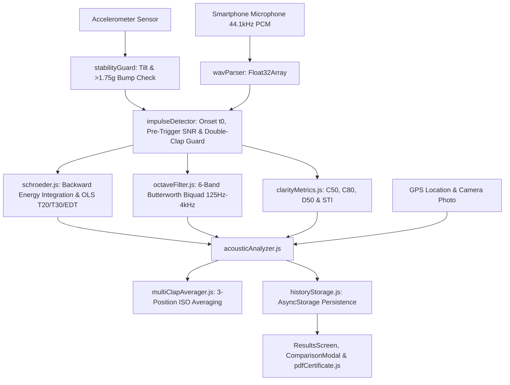

# AcoustiX (AcoustiTape) — Mobile Room Acoustics Instrument

**Project Code:** `2501010309`  
**Stack:** React Native (Pure JavaScript) • Expo SDK 58 • ISO 3382 DSP Engine

**AcoustiX (AcoustiTape)** turns any smartphone into a portable architectural acoustics analyzer. Using a single handclap (or the built-in test signal generator), it captures uncompressed PCM audio, runs **Manfred Schroeder's backward energy integration** directly on-device, and computes **$RT_{60}$**, **6-band octave spectra**, **Speech/Music Clarity ($C_{50}, C_{80}, D_{50}, \text{STI}$)**, **Room Modes**, and **Acoustic Treatment plans** — complete with hardware sensor guards, GPS geo-tagging, photo documentation, and printable **PDF compliance certificates**.

---

## 1. Problem Statement

Professional architectural acoustic testing requires Class-1 measurement microphones, omnidirectional dodecahedron loudspeakers, and dedicated spectrum analyzers costing thousands of dollars. Because of this cost and complexity, classrooms, lecture halls, home studios, podcast booths, and offices are rarely measured before or after acoustic treatment.

**AcoustiX** solves this by implementing the international **ISO 3382** room-acoustics standard on consumer mobile hardware:
- Replacing expensive hardware with **Schroeder backward integration** ($T_{20}, T_{30}, EDT$) that works reliably within a smartphone's $40\text{–}50\text{ dB}$ usable dynamic range.
- Protecting measurements against user handling errors using **accelerometer stability & tilt guards** and **block-RMS double-clap rejection**.
- Translating raw acoustic numbers into actionable engineering guidance: exact panel counts ($m^2$ of Rockwool/Foam/Bass Traps), standing-wave frequencies, and shareable **ISO 3382 PDF certificates**.

---

## 2. System Architecture



---

## 3. Core Capabilities & Mathematical Foundations

### ISO 3382 Reverberation & Clarity DSP
- **Schroeder Backward Integration** (`src/services/dsp/schroeder.js`):
  $$EDC[n] = \sum_{k=n}^{N-1} p^2[k], \qquad EDC_{\text{dB}}[n] = 10 \log_{10}\left(\frac{EDC[n]}{EDC[0]}\right)$$
  Extracts **$T_{20}$** ($-5$ to $-25\text{ dB}$, extrapolated $\times 3$), **$T_{30}$** ($-5$ to $-35\text{ dB}$, extrapolated $\times 2$), **Early Decay Time ($EDT$)** ($0$ to $-10\text{ dB}$, extrapolated $\times 6$), and OLS linearity **$R^2$**.
- **6-Band Octave Butterworth Filtering** (`src/services/dsp/octaveFilter.js`):
  Direct Form II transposed 2nd-order biquad bandpass filters centered at `125 Hz`, `250 Hz`, `500 Hz`, `1000 Hz`, `2000 Hz`, and `4000 Hz` ($Q = \sqrt{2}$), computing **Bass Ratio ($BR$)** and **Treble Ratio ($TR$)**.
- **Speech & Music Clarity** (`src/services/dsp/clarityMetrics.js`):
  Computes **$C_{50}$** (speech clarity), **$C_{80}$** (music clarity), **Definition ($D_{50}$)**, and **Speech Transmission Index ($\text{STI}$)** per IEC 60268-16.
- **3-Clap ISO Averaging** (`src/services/dsp/multiClapAverager.js`):
  Captures 3 room positions, averages $RT_{60}$, octave spectra, and Schroeder decay curves, and reports spatial standard deviation ($\sigma$).

### Architectural Engineering Tools
- **Acoustic Treatment Simulator** (`src/components/treatment/TreatmentSimulator.js`): Uses Sabine's equation ($A = 0.161 V / RT_{60}$) to compute $\Delta A$, required surface area ($m^2$), and exact panel counts for 50mm Rockwool, Pyramid Foam, Corner Bass Traps, Velour Curtains, and Timber Diffusers.
- **Room Modes & Standing Wave Calculator** (`src/services/dsp/roomModes.js`): Computes axial and tangential eigenfrequencies below $250\text{ Hz}$, the **Schroeder crossover frequency** ($f_s = 2000\sqrt{RT_{60}/V}$), and Bolt-area dimension ratio warnings.

---

## 4. Native Hardware & OS Integrations

| Native Feature | Expo / RN API | Source File | Purpose |
|:---|:---|:---|:---|
| **Microphone Capture** | `expo-av`, `expo-file-system` | `src/services/audio/audioRecorder.js` | Uncompressed 44.1 kHz PCM recording & live metering |
| **Test Signal Playback** | `expo-av`, `expo-file-system` | `src/services/audio/signalGenerator.js` | Synthesizes & plays Dirac impulse, Sine sweep & Pink noise WAVs |
| **Accelerometer Guard** | `expo-sensors` | `src/services/sensors/stabilityGuard.js` | Real-time spirit level & $>1.75g$ motion artifact rejection |
| **GPS & Geocoding** | `expo-location` | `src/services/location/locationService.js` | Geo-tags measurements & reverse-geocodes venue names |
| **Camera & Gallery** | `expo-image-picker` | `src/components/measurement/RoomPhotoPicker.js` | Attaches room boundary photos & surface material tags |
| **Persistent Storage** | `@react-native-async-storage/async-storage` | `src/services/storage/historyStorage.js` | Persists room audits & reloads last measurement on startup (`App.js`) |
| **PDF Certificate Export** | `expo-print`, `expo-sharing` | `src/services/export/pdfCertificate.js` | Renders & shares A4 ISO 3382 PDF compliance certificates |
| **Native Text Share** | `react-native` (`Share`) | `src/services/export/exportService.js` | Shares formatted text acoustic audit summaries |
| **Batch CSV Export** | `expo-file-system`, `expo-sharing` | `src/services/export/csvExporter.js` | Exports saved room audits to RFC-4180 `.csv` datasets |
| **Firebase Authentication** | `firebase` (`firebase/auth`) | `src/services/auth/authService.js` | Email/password sign-in, sign-up, reset & persistent session |
| **Acoustic Notifications** | `expo-notifications` | `src/services/notifications/notificationService.js` | Audit completion alerts, >85 dBA OSHA warnings & daily reminders |

---

## 5. Getting Started & Running Tests

### Prerequisites
- Node.js 18+
- Expo Go app on Android/iOS (or Android Studio / Xcode simulator)

### Installation & Launch
```bash
npm install
npx expo start
```

### Verification & Automated Tests
```bash
npm test              # Runs 10 unit tests covering DSP, clarity, room modes, averaging & WAV parser
npx expo-doctor       # Verifies Expo SDK 58 dependency & config health (20/20 checks)
```

---

## 6. Project Structure

```text
AcoustiX/
├── App.js                                    # Root tab navigator & startup AsyncStorage hydration
├── tests/dsp.test.js                         # Automated Node unit tests (npm test)
├── src/
│   ├── constants/                            # Dark studio theme & ISO 3382 room target specs
│   ├── screens/                              # MeasureScreen, ResultsScreen, HistoryScreen, AdvisorScreen
│   ├── components/
│   │   ├── charts/                           # SVG Schroeder DecayCurve, OctaveBars & Comparison overlays
│   │   ├── measurement/                      # LiveVUMeter, LevelBubble, SPLMeterModal, SignalGeneratorModal, RoomPhotoPicker
│   │   └── treatment/                        # TreatmentSimulator & RoomModesCalculator
│   └── services/
│       ├── audio/                            # audioRecorder, audioPermissions, wavParser, signalGenerator
│       ├── dsp/                              # impulseDetector, schroeder, octaveFilter, clarityMetrics, roomModes, multiClapAverager
│       ├── sensors/                          # stabilityGuard (Accelerometer)
│       ├── location/                         # locationService (GPS + reverse geocoding)
│       ├── storage/                          # historyStorage (AsyncStorage CRUD)
│       └── export/                           # pdfCertificate (HTML->PDF) & exportService (Share)
├── PROJECT_REPORT.md                         # Academic Major Project Report with proofs
└── DEMO_GUIDE.md                             # 3-minute classroom demo & viva Q&A script
```

---

## 7. AI (LLM) Usage, Iteration & Engineering Q&A

**Q1: How was AI used during the development of AcoustiX?**  
AI was used as a pair-programming partner across a 10-day sprint to scaffold the pure-JavaScript React Native architecture, derive the ISO 3382 DSP formulas (Schroeder backward integration, biquad Butterworth coefficients, $C_{50}/C_{80}$ clarity, and room eigenfrequencies), and build SVG visualizations and automated unit tests.

**Q2: What real bugs were caught and fixed through testing & iteration?**  
1. **Zero-crossing false valleys in double-clap detection:** Checking raw sample amplitudes triggered false double-clap rejections because AC audio crosses zero continuously. Switched to an 8 ms block-RMS energy envelope.
2. **Pre-peak double-clap blind spot (caught by `npm test`):** When a second clap was louder than the first, global peak detection anchored on the second clap and missed the first. Added a symmetric backward RMS scan before `peakBlock` in `src/services/dsp/impulseDetector.js`.
3. **Pre-trigger noise floor contamination:** Measuring background noise immediately adjacent to onset $t_0$ polluted the baseline with the clap's rising edge. Added a 15 ms safety guard prior to $t_0$.
4. **Silent numeric fallbacks in calculators:** Replaced silent `parseFloat(x) || default` fallbacks with explicit inline validation banners when users enter invalid or non-positive room dimensions.

**Q3: What did you learn from building this project?**  
Consumer smartphones cannot measure a full $60\text{ dB}$ decay directly due to microphone noise floors ($-45\text{ to }-50\text{ dBFS}$). Implementing ISO 3382 $T_{20}/T_{30}$ regression over Schroeder's reverse integral — combined with automated unit tests and hardware sensor guards — turns a noisy consumer microphone into a repeatable architectural acoustics instrument.
